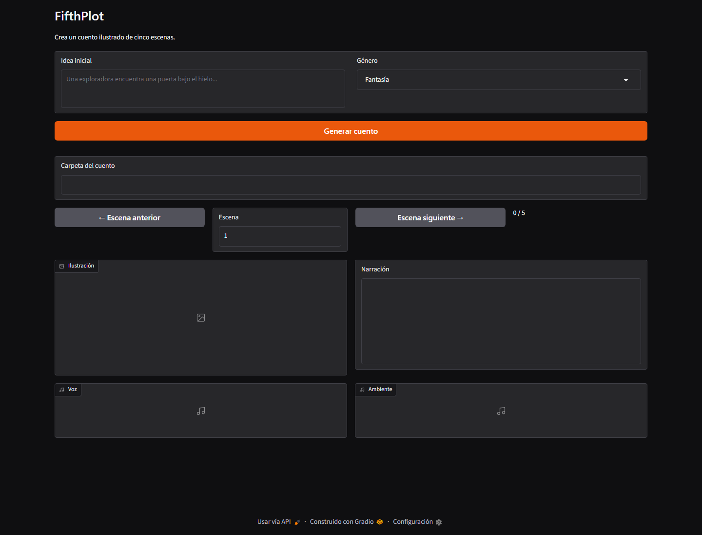

# Índice de evidencias

Este índice diferencia lo observado de lo que sigue pendiente. Solo se agregarán resultados académicos como supervisados o manuales cuando el estudiante efectivamente los haya supervisado o ejecutado.

## Capturas guardadas

| Archivo | Etapa | Qué demuestra | Alcance |
|---|---|---|---|
| [fifthplot-formulario-inicial.png](screenshots/01-interfaz/fifthplot-formulario-inicial.png) | Interfaz inicial | Captura directa de la aplicación FifthPlot servida localmente. Muestra los campos de idea y género, el control de escenas y los paneles vacíos de ilustración, narración, voz y ambiente. Archivo guardado el 23 de noviembre de 2026 a la 1:02 a. m. (hora local del equipo). | Solo demuestra que la interfaz carga. No demuestra que se haya generado un cuento ni que la integración completa funcione. |

## Resultado generado localmente

- [Ejecución supervisada `20261123_021143_e0298b90`](../../outputs/storybooks/la-zorra-y-el-bosque-de-estrellas-perdidas_20261123_021143_e0298b90/manifest.json): manifiesto con estado `complete`; la interfaz mostró el cuento, escena 1 y controles de voz y ambiente. El estudiante propuso la idea; género Fantasía; estrategia `text_only`. Se guardaron cinco ilustraciones de 512×512 y narración y ambiente para cada escena con modelos locales. RAM disponible al cierre: 2,84 GB. Los artefactos originales demuestran el resultado; la captura de pantalla de la interfaz con este resultado queda pendiente.
- [Carpeta de ejecución `20261123_014610_11ebec14`](../../outputs/storybooks/la-br-jula-de-los-sue-os-perdidos_20261123_014610_11ebec14/manifest.json): manifiesto con estado `complete`, cuento validado, referencia de personaje, cinco ilustraciones de 512×512 y archivos de narración y ambiente por escena. La ejecución usó Qwen3 4B Q4, DreamShaper 8, IP-Adapter Plus SD15 y Piper local. La escena 1 fue inspeccionada visualmente. Esta referencia apunta a los artefactos originales de la ejecución; todavía no es una captura de pantalla de la interfaz.

## Pendiente de evidencia

- Historia validada con cinco escenas para cada uno de tres géneros distintos.
- Comparación visual de texto solamente frente a IP-Adapter con mismos parámetros controlados.
- Captura real de la interfaz mostrando el resultado integrado y sus controles.
- Revisión visual comparativa de las cinco ilustraciones y escucha de narraciones/ambientes antes de citarlos en el informe o video.

La muestra de audio existente en `experiments/audio_pilot/` es un piloto técnico aislado; no se registra aquí como ejecución supervisada por el estudiante ni como resultado completo de FifthPlot.

## Historial preexistente conservado

Estos archivos ya estaban en `docs/evidence/`; se mantienen sin modificar. Corresponden a material del prototipo previo y requieren revisión antes de citarlos como evidencia del flujo actual.

- [auditoria_generador_visual.txt](auditoria_generador_visual.txt): auditoría técnica y extractos del prototipo anterior.
- [revision_automatizacion.txt](revision_automatizacion.txt): revisión y extractos del flujo anterior.
- [Reportes de prompts](prompt_reports/historia_20261121_023249_prompt_report.txt), [versión 2](prompt_reports/historia_20261121_023249_prompt_report_v2.txt) y [versión 3](prompt_reports/historia_20261121_023249_prompt_report_v3.txt): prompts visuales históricos.
- `backups/`: copias de código y datos previos a cambios del prototipo anterior.
